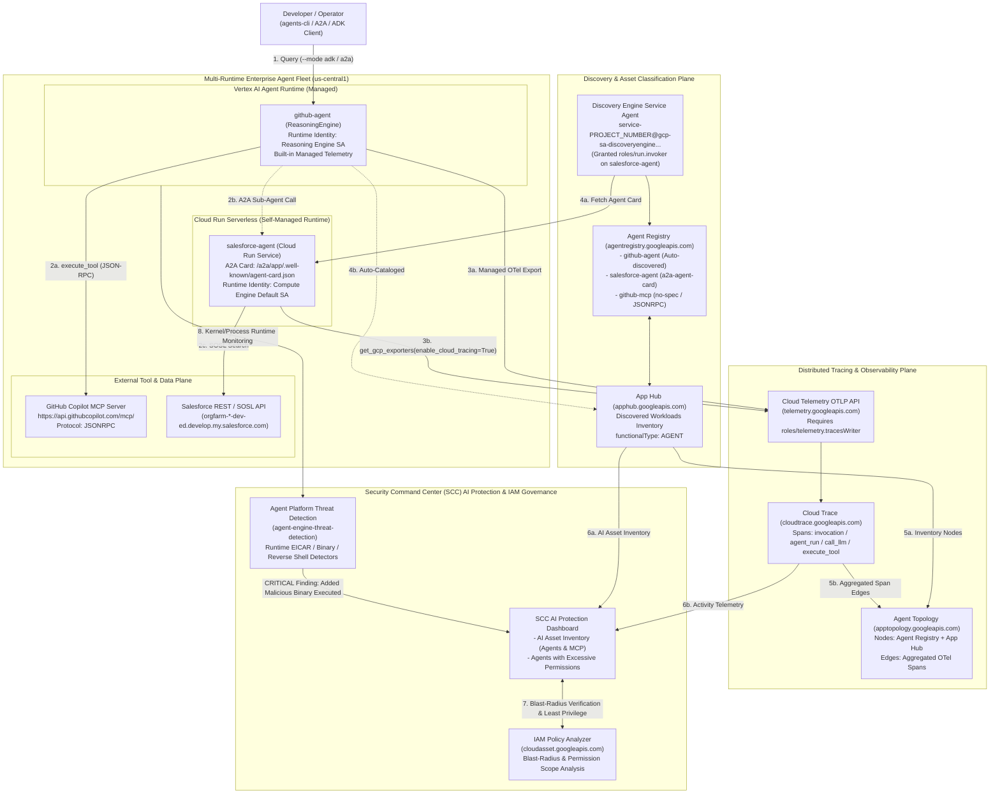

# Agent Observability, Topology & Security Command Center AI Protection — Complete Runbook, HLD, LLD & Workflows

> **Lab URL:** [https://explore.qwiklabs.com/classrooms/21504/labs/115876](https://explore.qwiklabs.com/classrooms/21504/labs/115876)  
> **Key Technologies:** Google Cloud Agent Registry (`agentregistry.googleapis.com`), App Hub (`apphub.googleapis.com`), Agent Topology (`apptopology.googleapis.com`), Cloud Trace (`cloudtrace.googleapis.com`), Cloud Telemetry OTLP API (`telemetry.googleapis.com`), OpenTelemetry GenAI (`google-adk[otel-gcp]`, `opentelemetry-instrumentation-google-genai`), Vertex AI Agent Runtime (`ReasoningEngine`), Cloud Run (`a2a-sdk`), Security Command Center (SCC) AI Protection, IAM Policy Analyzer (`cloudasset.googleapis.com`), Agent Platform Threat Detection (`agent-engine-threat-detection`)

---

## Repository Structure

| File / Directory | Description |
| :--- | :--- |
| [`README.md`](./README.md) | Master document containing Executive Summary, High-Level Design (HLD), Low-Level Design (LLD), Step-by-Step Workflows, and Full Operational Runbook |
| [`docs/HIGH_LEVEL_DESIGN.md`](./docs/HIGH_LEVEL_DESIGN.md) | High-Level Architecture Design (HLD), Multi-Runtime Discovery & Telemetry Architecture, and Security Posture Transformation |
| [`docs/LOW_LEVEL_DESIGN.md`](./docs/LOW_LEVEL_DESIGN.md) | Low-Level Design (LLD), OpenTelemetry GenAI Instrumentation Specs, Agent Registry Schemas (`a2a-agent-card` & `no-spec` MCP), IAM Least-Privilege Matrix, and Threat Detection Specs |
| [`docs/WORKFLOWS.md`](./docs/WORKFLOWS.md) | Visual Mermaid Sequence & Flowchart Diagrams for every step of the lab (Tasks 1–10) |
| [`docs/RUNBOOK.md`](./docs/RUNBOOK.md) | Copy-pasteable Step-by-Step Operational Runbook covering Tasks 1–10 with verified outputs & troubleshooting |
| [`agents/github-agent/`](./agents/github-agent/) | Vertex AI Agent Runtime (`github-agent`) ADK implementation with OpenTelemetry GenAI instrumentation and GitHub MCP integration |
| [`agents/salesforce-agent/`](./agents/salesforce-agent/) | Cloud Run A2A Agent (`salesforce-agent`) ADK implementation with OpenTelemetry GenAI instrumentation and Salesforce SOSL search tool |
| [`configs/salesforce_card.json`](./configs/salesforce_card.json) | Downloaded A2A Agent Card (`/.well-known/agent-card.json`) used to register `salesforce-agent` in Agent Registry |
| [`scripts/lab2_prereqs.sh`](./scripts/lab2_prereqs.sh) | Prerequisite script that deploys the baseline `github-agent` (Agent Runtime) and `salesforce-agent` (Cloud Run) fleet |
| [`threat_test/`](./threat_test/) | Task 10 throwaway test agent (`scc_threat_test_agent`) that triggers the `Execution: Added Malicious Binary Executed` (EICAR) detector in Agent Platform Threat Detection |

---

## 1. Executive Summary & Lab Objective

In a multi-agent enterprise architecture, AI workloads span multiple runtimes (Vertex AI Agent Runtime and Cloud Run) and external tool protocols (Model Context Protocol / MCP and Agent-to-Agent / A2A). Managing observability and security across this fleet requires two foundational capabilities:
1. **Multi-Runtime Discovery (Nodes):** Cataloging every agent and MCP server in **App Hub** and **Agent Registry** so the platform knows which services are AI agents (`functionalType: AGENT`) and which endpoints are MCP tool servers.
2. **Distributed Trace Aggregation (Edges):** Exporting OpenTelemetry GenAI spans (`invocation`, `agent_run`, `call_llm`, `execute_tool`) through the **Cloud Telemetry OTLP API** (`telemetry.googleapis.com`) into **Cloud Trace** so **Agent Topology** and **Security Command Center (SCC) AI Protection** can reconstruct live runtime relationships.

Once the fleet is discoverable and traceable, **SCC AI Protection**, **IAM Policy Analyzer**, and **Agent Platform Threat Detection** provide end-to-end security governance:
- Detecting and remediating **Non-Human Identity (NHI) excessive permissions** (`roles/editor` on `salesforce-agent`'s service account) down to strict least privilege.
- Detecting real-time **runtime container attacks** (`Execution: Added Malicious Binary Executed`) when an agent executes an unauthorized binary (simulated safely with the standard EICAR test file).

---

## 2. High-Level Design (HLD)

> Full details in [`docs/HIGH_LEVEL_DESIGN.md`](./docs/HIGH_LEVEL_DESIGN.md).



---

## 3. Low-Level Design (LLD)

> Full details in [`docs/LOW_LEVEL_DESIGN.md`](./docs/LOW_LEVEL_DESIGN.md).

### 3.1 Multi-Runtime Discovery & Telemetry Matrix

| Workload | Runtime | Discovery Mechanism | Trace Export Mechanism |
| :--- | :--- | :--- | :--- |
| **`github-agent`** | Vertex AI Agent Runtime (`reasoningEngines/2580054886989168640`) | Auto-discovered in **App Hub** (`functionalType: AGENT`) and **Agent Registry**. | Managed built-in telemetry; no per-agent IAM role grant required. |
| **`salesforce-agent`** | Cloud Run (`salesforce-agent`) | Registered via `gcloud alpha agent-registry services create salesforce-agent --agent-spec-type=a2a-agent-card` after granting `roles/run.invoker` to `service-PROJECT_NUMBER@gcp-sa-discoveryengine.iam.gserviceaccount.com`. | Exports OTLP spans via `get_gcp_exporters(enable_cloud_tracing=True)` using the Cloud Run service account (`roles/telemetry.tracesWriter`). |
| **`github-mcp`** | External MCP Server (`https://api.githubcopilot.com/mcp/`) | Registered via `gcloud alpha agent-registry services create github-mcp --mcp-server-spec-type=no-spec --interfaces=url=...,protocolBinding=JSONRPC`. | Represented via `execute_tool` spans emitted by `github-agent`. |

### 3.2 Least-Privilege IAM Specification for `salesforce-agent`

| Role | Status | Purpose |
| :--- | :--- | :--- |
| `roles/aiplatform.user` | **Retained** | Invoke Vertex AI Gemini models |
| `roles/telemetry.tracesWriter` | **Retained (Granted in Task 2)** | Export OpenTelemetry spans to `telemetry.googleapis.com` |
| `roles/logging.logWriter` | **Retained** | Write structured application & GenAI logs to Cloud Logging |
| `roles/cloudtrace.agent` | **Retained** | Write trace data to Cloud Trace |
| `roles/editor` | **Removed in Task 9** | Excessive project-wide primitive role simulated in Task 7 and proven in Task 8 via Policy Analyzer |

---

## 4. Workflows for Each Task (Tasks 1–10)

> Full sequence and flowchart diagrams for every step are available in [`docs/WORKFLOWS.md`](./docs/WORKFLOWS.md).

```mermaid
flowchart LR
    T1["Task 1<br/>Prepare Environment &<br/>Enable Observability/Discovery APIs"]
    T2["Task 2<br/>Grant tracesWriter Role &<br/>Emit OpenTelemetry Spans"]
    T3["Task 3<br/>Confirm Auto-Discovery of<br/>Agent Runtime (github-agent)"]
    T4["Task 4<br/>Grant run.invoker & Register<br/>Cloud Run Agent (salesforce-agent)"]
    T5["Task 5<br/>Register External MCP Server<br/>(github-mcp) in Agent Registry"]
    T6["Task 6<br/>Inspect Unified<br/>Agent Topology Graph"]
    T7["Task 7<br/>Review SCC AI Protection &<br/>Simulate Over-Privilege (roles/editor)"]
    T8["Task 8<br/>Prove Blast Radius with<br/>IAM Policy Analyzer"]
    T9["Task 9<br/>Remediate Service Account &<br/>Verify Least Privilege"]
    T10["Task 10 (Optional)<br/>Trigger & View Agent Platform<br/>Threat Detection (EICAR)"]

    T1 --> T2 --> T3 --> T4 --> T5 --> T6 --> T7 --> T8 --> T9 --> T10
```



---

## 5. Step-by-Step Runbook Summary

> Full copy-pasteable commands, expected outputs, and troubleshooting are in [`docs/RUNBOOK.md`](./docs/RUNBOOK.md).

### Task 1: Prepare Environment & Enable APIs
```bash
export PROJECT_ID=qwiklabs-gcp-01-f67f64703dca
export LOCATION=us-central1
gcloud config set project ${PROJECT_ID}
export PROJECT_NUMBER=$(gcloud projects describe ${PROJECT_ID} --format='value(projectNumber)')
export ORGANIZATION_ID=$(gcloud projects get-ancestors ${PROJECT_ID} --format=json | jq -r '.[] | select(.type=="organization") | .id')

gcloud storage cp -r gs://${PROJECT_ID}-bucket/apex_labs .
bash apex_labs/lab2_prereqs.sh

gcloud storage cp -r gs://${PROJECT_ID}-bucket/agents .
mkdir -p ~/.vscode
gcloud storage cp -r gs://${PROJECT_ID}-bucket/settings.json ~/.vscode/

export PATH="${HOME}/.local/bin:${PATH}"
uvx google-agents-cli setup
uv tool upgrade google-agents-cli
agents-cli info

gcloud services enable \
  observability.googleapis.com \
  cloudtrace.googleapis.com \
  telemetry.googleapis.com \
  apphub.googleapis.com \
  apptopology.googleapis.com \
  agentregistry.googleapis.com \
  cloudasset.googleapis.com \
  monitoring.googleapis.com \
  logging.googleapis.com \
  --project=${PROJECT_ID}
```

### Task 2: Grant `roles/telemetry.tracesWriter` & Emit Traces
```bash
export SF_SA="${PROJECT_NUMBER}-compute@developer.gserviceaccount.com"
gcloud projects add-iam-policy-binding ${PROJECT_ID} \
  --member="serviceAccount:${SF_SA}" \
  --role="roles/telemetry.tracesWriter" \
  --condition=None

export GH_ENGINE_NAME=$(curl -s -H "Authorization: Bearer $(gcloud auth print-access-token)" \
  "https://${LOCATION}-aiplatform.googleapis.com/v1/projects/${PROJECT_ID}/locations/${LOCATION}/reasoningEngines" \
  | jq -r '(.reasoningEngines // [])[] | select(.displayName=="github-agent") | .name' | head -n 1)

agents-cli run \
  --url "https://${LOCATION}-aiplatform.googleapis.com/v1/${GH_ENGINE_NAME}" \
  --mode adk \
  --app-name app \
  "Find the google/adk-python repository and list 3 open issues"
```

### Task 3: Confirm Agent Runtime Auto-Discovery
```bash
gcloud alpha agent-registry agents list --location=${LOCATION} --project=${PROJECT_ID} --format="table(displayName)"

export TOKEN=$(gcloud auth print-access-token)
curl -s -H "Authorization: Bearer ${TOKEN}" -H "x-goog-user-project: ${PROJECT_ID}" \
  "https://apphub.googleapis.com/v1/projects/${PROJECT_ID}/locations/${LOCATION}/discoveredWorkloads" \
  | jq -r '.discoveredWorkloads[] | "\(.workloadProperties.functionalType.type // "-")\t\(.workloadReference.uri)"'
```

### Task 4: Grant Discovery Engine Invoker Access & Register `salesforce-agent`
```bash
gcloud beta services identity create \
  --service=discoveryengine.googleapis.com \
  --project=${PROJECT_ID}

gcloud run services add-iam-policy-binding salesforce-agent \
  --region=${LOCATION} \
  --project=${PROJECT_ID} \
  --member="serviceAccount:service-${PROJECT_NUMBER}@gcp-sa-discoveryengine.iam.gserviceaccount.com" \
  --role="roles/run.invoker"

export SF_URL=$(gcloud run services describe salesforce-agent --region=${LOCATION} --format='value(status.url)')
export TOKEN=$(gcloud auth print-identity-token)
curl -s -H "Authorization: Bearer ${TOKEN}" \
  "${SF_URL}/a2a/app/.well-known/agent-card.json" -o salesforce_card.json

gcloud alpha agent-registry services create salesforce-agent \
  --location=${LOCATION} \
  --project=${PROJECT_ID} \
  --agent-spec-type=a2a-agent-card \
  --agent-spec-content="$(cat salesforce_card.json)"
```

### Task 5: Register the GitHub MCP Server (`github-mcp`)
```bash
gcloud alpha agent-registry services create github-mcp \
  --location=${LOCATION} \
  --project=${PROJECT_ID} \
  --mcp-server-spec-type=no-spec \
  --interfaces=url=https://api.githubcopilot.com/mcp/,protocolBinding=JSONRPC

gcloud alpha agent-registry mcp-servers list --location=${LOCATION} --project=${PROJECT_ID}
```

### Tasks 6–9: View Agent Topology, Simulate Over-Privilege, Analyze with Policy Analyzer & Remediate to Least Privilege
```bash
# Task 7: Simulate excessive permissions
export SF_SA=$(gcloud run services describe salesforce-agent --region=${LOCATION} \
  --format='value(spec.template.spec.serviceAccountName)')
gcloud projects add-iam-policy-binding ${PROJECT_ID} \
  --member="serviceAccount:${SF_SA}" \
  --role="roles/editor" --condition=None

# Task 9: Inspect current roles, remove roles/editor, and verify least privilege
gcloud projects get-iam-policy ${PROJECT_ID} --flatten="bindings[].members" \
  --filter="bindings.members:${SF_SA}" \
  --format="value(bindings.role)"

gcloud projects remove-iam-policy-binding ${PROJECT_ID} \
  --member="serviceAccount:${SF_SA}" \
  --role="roles/editor"

gcloud projects get-iam-policy ${PROJECT_ID} \
  --flatten="bindings[].members" \
  --filter="bindings.members:${SF_SA} AND bindings.role:roles/editor" \
  --format="value(bindings.role)"
```

### Task 10 (Optional): Trigger and View Agent Platform Threat Detection Findings
```bash
gcloud services enable \
  containerthreatdetection.googleapis.com \
  securitycentermanagement.googleapis.com \
  securitycenter.googleapis.com \
  --project=${PROJECT_ID}

gcloud scc manage services update agent-engine-threat-detection \
  --project=${PROJECT_ID} \
  --enablement-state=ENABLED \
  --quiet

cd threat_test
uv venv env && source env/bin/activate
uv pip install -r requirements.txt
python3 main.py

gcloud scc findings list projects/${PROJECT_NUMBER} \
  --filter='category="Execution: Added Malicious Binary Executed"' \
  --format="table(finding.category,finding.resourceName,finding.eventTime,finding.severity)"
```
