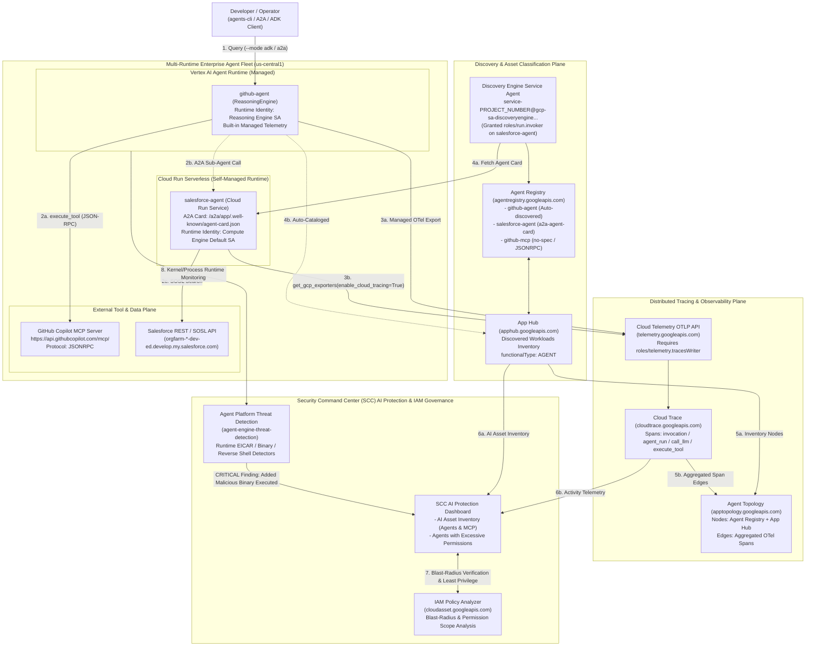

# High-Level Design (HLD) — Agent Observability, Topology & SCC AI Protection

> **Lab URL:** [https://explore.qwiklabs.com/classrooms/21504/labs/115876](https://explore.qwiklabs.com/classrooms/21504/labs/115876)  
> **Scope:** Multi-Runtime Agent Discovery (Agent Registry & App Hub), OpenTelemetry GenAI Distributed Tracing (`telemetry.googleapis.com` & Cloud Trace), Agent Topology Graph Generation, Security Command Center (SCC) AI Protection Inventory & Least-Privilege Remediation, and Agent Platform Threat Detection (`AGENT_ENGINE_ADDED_MALICIOUS_BINARY_EXECUTED`).

---

## 1. Architectural Vision & Problem Statement

Modern enterprise AI systems span heterogeneous compute runtimes and external tool protocols:
- **Managed Agent Runtimes** (Vertex AI Agent Runtime / `ReasoningEngine`) running orchestrator or specialist agents (`github-agent`).
- **Containerized Serverless Runtimes** (Cloud Run) hosting custom A2A (Agent-to-Agent) specialist agents (`salesforce-agent`).
- **External & Internal MCP Servers** (`https://api.githubcopilot.com/mcp/`) invoked over JSON-RPC 2.0.

Without unified **discovery** and **distributed trace correlation**:
1. **Blind Spots in Inventory:** Cloud Run services look like generic web microservices rather than AI agents, and external MCP servers are invisible to cloud asset inventories.
2. **Missing Topology Edges:** Even when agents are registered, static registration only creates disconnected **nodes**. Understanding how requests actually flow across agents, LLMs, and MCP tools requires aggregating OpenTelemetry GenAI spans (`agent_run`, `call_llm`, `execute_tool`) exported to the Cloud Telemetry OTLP API.
3. **Unmonitored Identity & Runtime Threats:** Over-privileged agent service accounts (e.g., `roles/editor` on default compute service accounts) and runtime container attacks (malicious binary execution, reverse shells, container escapes) go undetected unless cataloged in **Security Command Center (SCC) AI Protection** and monitored by **Agent Platform Threat Detection**.

---

## 2. End-to-End Target Architecture

---

## 3. Core Architectural Pillars

### 3.1 Pillar 1: Unified Multi-Runtime Discovery (Nodes)
Before an agent or tool server can appear as a node in **Agent Topology** or as a monitored AI asset in **SCC AI Protection**, Google Cloud must know both that the workload exists and that its functional role is an **Agent** or **MCP Server**:

| Workload Type | Runtime | Discovery Mechanism | Action Required |
| :--- | :--- | :--- | :--- |
| **`github-agent`** | Vertex AI Agent Runtime (`ReasoningEngine`) | Automatically cataloged in **App Hub** (`discoveredWorkloads`) with `functionalType.type = AGENT` and listed in **Agent Registry**. | **None** (Zero-touch auto-discovery). |
| **`salesforce-agent`** | Cloud Run (`run.googleapis.com`) | Appears as a generic Cloud Run workload until explicitly registered in **Agent Registry** with its A2A Agent Card (`--agent-spec-type=a2a-agent-card`). Requires granting `roles/run.invoker` to `service-PROJECT_NUMBER@gcp-sa-discoveryengine.iam.gserviceaccount.com`. | **Explicit Registration** (`gcloud alpha agent-registry services create salesforce-agent`). |
| **`github-mcp`** | External HTTPS Endpoint (`https://api.githubcopilot.com/mcp/`) | Registered in **Agent Registry** with `--mcp-server-spec-type=no-spec` and `--interfaces=url=...,protocolBinding=JSONRPC`. Cataloged into MCP inventory once `apphub.googleapis.com` is enabled. | **Explicit Registration** (`gcloud alpha agent-registry services create github-mcp`). |

### 3.2 Pillar 2: OpenTelemetry GenAI Distributed Tracing (Edges)
Nodes without traces produce an empty topology graph with no edges. Every agent in the fleet relies on a three-part telemetry pipeline:
1. **Instrumentation Library:** `google-adk[otel-gcp]` installs `opentelemetry-instrumentation-google-genai`, automatically generating semantic GenAI spans (`invocation`, `agent_run`, `call_llm`, `execute_tool`).
2. **Exporter Configuration:** `setup_telemetry()` in `app/app_utils/telemetry.py` invokes `get_gcp_exporters(enable_cloud_tracing=True)`, targeting the **Cloud Telemetry OTLP API** (`telemetry.googleapis.com`).
3. **Runtime IAM Authorization:**
   - **Vertex AI Agent Runtime (`github-agent`):** Exports traces via Google-managed built-in telemetry; no per-agent IAM binding is required.
   - **Cloud Run (`salesforce-agent`):** Exports traces using its attached service account (`PROJECT_NUMBER-compute@developer.gserviceaccount.com`), which must be explicitly granted `roles/telemetry.tracesWriter`.

### 3.3 Pillar 3: Posture Governance & Least-Privilege IAM Remediation
Once agents are registered in Agent Registry and cataloged by App Hub, **SCC AI Protection** correlates asset inventory with IAM policies to flag **Non-Human Identity (NHI) risks**, such as **Agents with excessive permissions**:
- **Risk Detection:** Granting `roles/editor` (or leaving the default Compute Engine service account's broad `roles/editor` binding) on `salesforce-agent`'s service account triggers an excessive-permissions posture risk.
- **Blast-Radius Proof:** **IAM Policy Analyzer** (`cloudasset.googleapis.com`) proves the exact scope of `roles/editor` across all project resources immediately.
- **Right-Sizing to Least Privilege:** Removing `roles/editor` while preserving only the four narrow operational roles (`roles/aiplatform.user`, `roles/telemetry.tracesWriter`, `roles/logging.logWriter`, `roles/cloudtrace.agent`) eliminates the risk without disrupting model invocation or trace export.

### 3.4 Pillar 4: Real-Time Runtime Threat Detection
While posture management governs static IAM configurations, **Agent Platform Threat Detection** (`agent-engine-threat-detection`) monitors live Agent Runtime containers for active exploitation:
- Detects runtime attacks including **Added Malicious Binary Executed**, **Added Malicious Library Loaded**, **Container Escape**, **Reverse Shell**, **Malicious Python/Script Executed**, and **Malicious URL Observed**.
- Generates near-real-time `CRITICAL` findings in Security Command Center enriched with process metadata, CLI arguments, SHA-256 hashes, VirusTotal links, and MITRE ATT&CK mappings.

---

## 4. Security & Observability Transformation Matrix

| Dimension | Baseline State (Before Lab) | Target State (After Lab) |
| :--- | :--- | :--- |
| **Cloud Run Trace Export** | Fails silently due to missing OTLP permission on `telemetry.googleapis.com`. | Authorized via `roles/telemetry.tracesWriter` on the Cloud Run service account. |
| **Multi-Runtime Inventory** | Only `github-agent` (Agent Runtime) is known; `salesforce-agent` (Cloud Run) and `github-mcp` are uncataloged. | Full fleet (`github-agent`, `salesforce-agent`, `github-mcp`) unified in Agent Registry & App Hub. |
| **Agent Topology Graph** | Disconnected or missing nodes; no cross-runtime or MCP tool call edges. | Connected topology graph showing agents across Agent Runtime & Cloud Run plus MCP server edges. |
| **Agent Service Account IAM** | Over-privileged with `roles/editor` (project-wide modification blast radius). | Right-sized to 4 least-privilege roles (`aiplatform.user`, `telemetry.tracesWriter`, `logging.logWriter`, `cloudtrace.agent`). |
| **Runtime Threat Monitoring** | Unverified runtime attack surface. | Verified `agent-engine-threat-detection` generating `CRITICAL` SCC findings on EICAR binary execution. |
