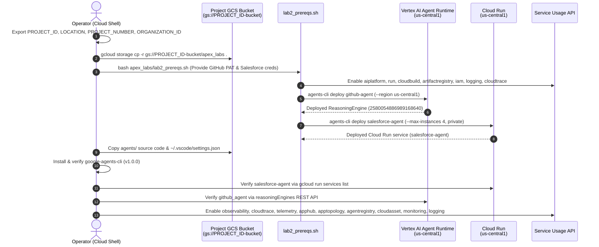
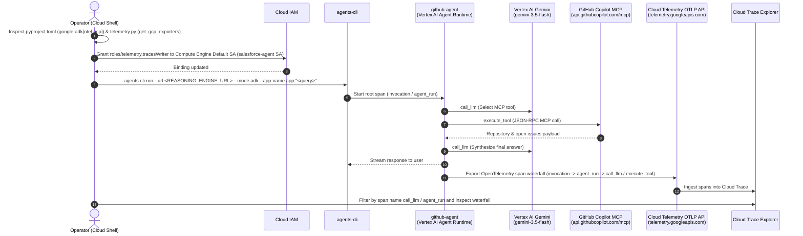
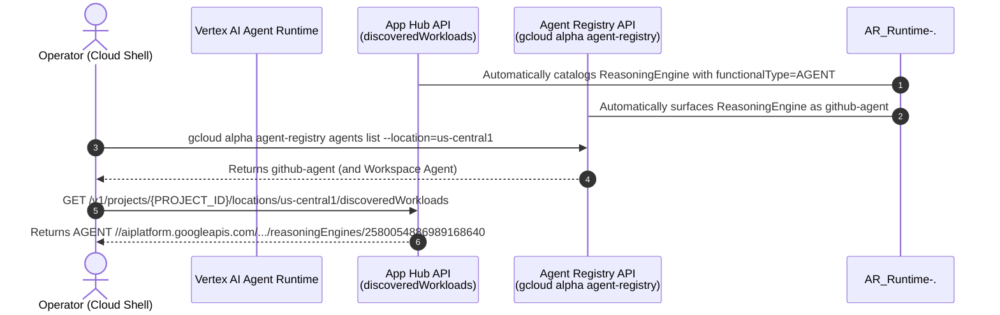
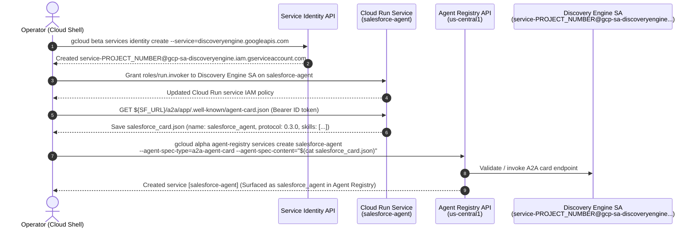
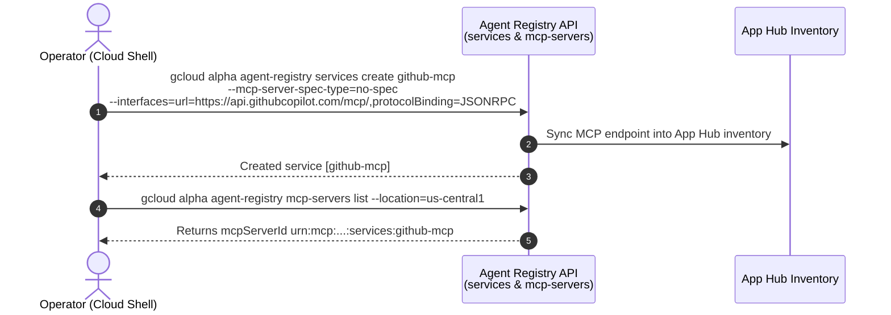
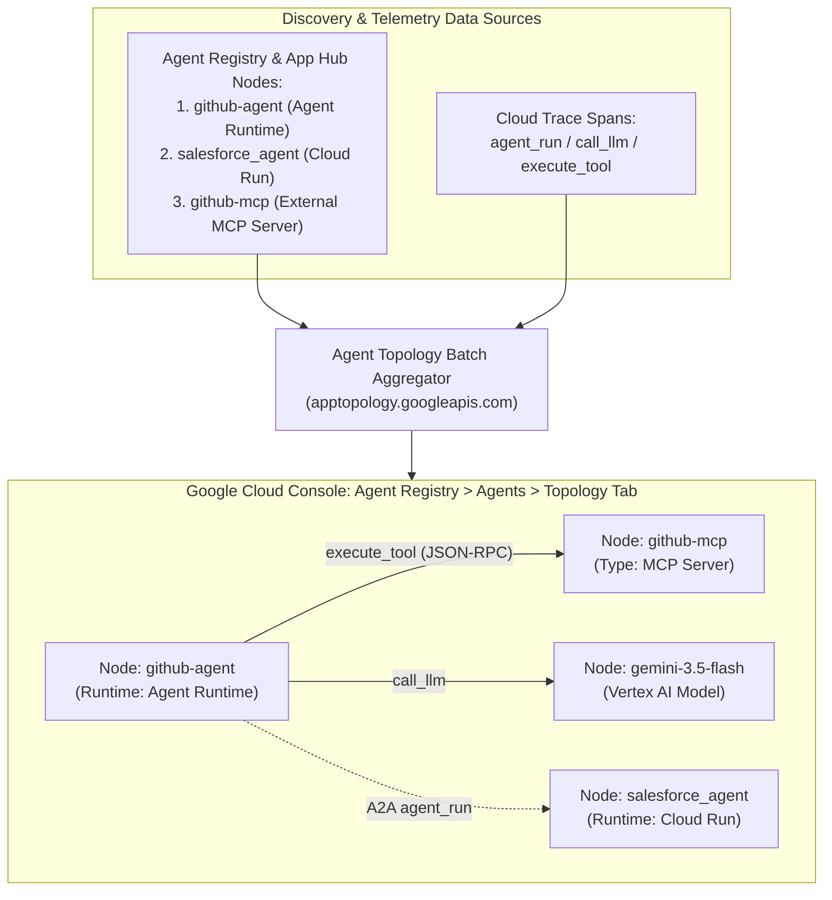
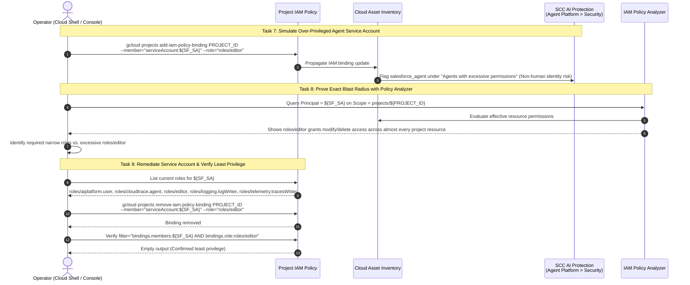
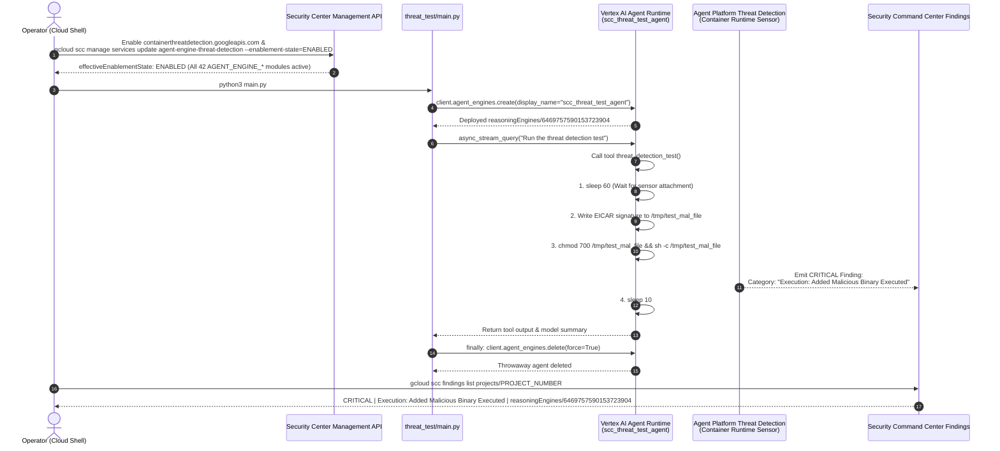

# Step-by-Step Workflows — Agent Observability, Topology & SCC AI Protection

> **Lab URL:** [https://explore.qwiklabs.com/classrooms/21504/labs/115876](https://explore.qwiklabs.com/classrooms/21504/labs/115876)

---

## Master Lab Execution Flow (Tasks 1–10)

```mermaid
flowchart LR
    T1["Task 1<br/>Prepare Environment &<br/>Enable Observability/Discovery APIs"]
    T2["Task 2<br/>Grant tracesWriter Role &<br/>Emit OpenTelemetry Spans"]
    T3["Task 3<br/>Confirm Auto-Discovery of<br/>Agent Runtime (github-agent)"]
    T4["Task 4<br/>Grant run.invoker & Register<br/>Cloud Run Agent (salesforce-agent)"]
    T5["Task 5<br/>Register External MCP Server<br/>(github-mcp) in Agent Registry"]
    T6["Task 6<br/>Inspect Unified<br/>Agent Topology Graph"]
    T7["Task 7<br/>Review SCC AI Protection &<br/>Simulate Over-Privilege (roles/editor)"]
    T8["Task 8<br/>Prove Blast Radius with<br/>IAM Policy Analyzer"]
    T9["Task 9<br/>Remediate Service Account &<br/>Verify Least Privilege"]
    T10["Task 10 (Optional)<br/>Trigger & View Agent Platform<br/>Threat Detection (EICAR)"]

    T1 --> T2 --> T3 --> T4 --> T5 --> T6 --> T7 --> T8 --> T9 --> T10
```

---

## Task 1 Workflow: Environment Preparation, Baseline Fleet Deployment & API Enablement

---

## Task 2 Workflow: OpenTelemetry Trace Export & Traffic Generation

---

## Task 3 Workflow: Confirming Auto-Discovery of Agent Runtime Workloads

---

## Task 4 Workflow: Registering the Cloud Run A2A Agent (`salesforce-agent`)

---

## Task 5 Workflow: Registering the External GitHub MCP Server (`github-mcp`)

---

## Task 6 Workflow: Viewing the Unified Multi-Runtime Agent Topology Graph

---

## Tasks 7, 8 & 9 Workflow: SCC AI Protection Risk Simulation, Policy Analyzer Scope Proof & Least-Privilege Remediation

---

## Task 10 Workflow: Triggering & Viewing Real-Time Agent Platform Threat Detection

